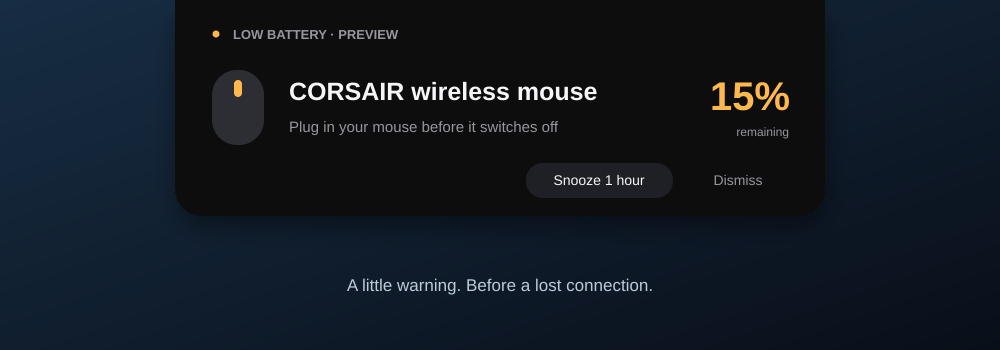

# Battery Alerts

[](https://github.com/GlennMitchellAU/battery-alerts/actions/workflows/build.yml)
[](LICENSE)

A small Windows tray utility that warns before a wireless device runs out of
battery. A black island expands from the top centre of the primary display,
shows the device and charge remaining, then slips away. **Automatic alerts do not
take keyboard focus.**



*Illustration of the native island. The labelled 15% preview is simulated.*

Built in Rust with native Win32 drawing. No installer, Windows service, browser
engine, administrator privileges or .NET runtime is required.

## Status and device support

**0.1.0 is a preview version. Support is not universal.** Bluetooth and USB wireless
receivers expose battery information in different ways.

| Connection | Support |
| --- | --- |
| Corsair SLIPSTREAM receiver `1B1C:1BDC`, validated mouse interface | Live battery GET verified on one receiver; works with iCUE closed |
| Bluetooth LE standard Battery service | Reader implemented; needs a readable `180F` / `2A19` service and physical compatibility confirmation |
| Corsair devices exposed by iCUE | Optional SDK provider; depends on iCUE exposing the battery property |
| Cached Windows readings | Shown as last known; never used for alerts |
| Other receivers or vendor-specific earbuds | Additional providers needed |

See [compatibility and troubleshooting](docs/compatibility.md) for precise receiver
restrictions and SDK setup. [Validation](docs/validation.md) distinguishes observed
hardware behaviour from automated checks and remaining physical tests.

## Get started

On Windows 10/11 x64, either build from source below or download the portable ZIP
and checksum from a successful [Build run](https://github.com/GlennMitchellAU/battery-alerts/actions/workflows/build.yml).
Build artifacts require a GitHub sign-in. A public release download will appear
on the [Releases page](https://github.com/GlennMitchellAU/battery-alerts/releases)
when a release is published.

1. Extract the complete ZIP into a writable folder.
2. Run `battery-alerts.exe`.
3. Click the battery icon in the notification area to check device status.
4. Right-click the icon for a preview, snooze, settings or exit.

The native package includes the app, configuration, usage notes and license texts.
It omits the proprietary Corsair SDK. The validated receiver uses the direct reader
while iCUE is closed. Executables are currently unsigned.

To check a downloaded ZIP, compare `Get-FileHash -Algorithm SHA256 <zip-path>` with
the adjacent `.sha256` file.

## Alerts and settings

- Warning at **20%**, critical at **10%**. Critical escalation alerts immediately.
- Warning reminders every four hours; critical reminders every hour.
- Reminders survive restart and rearm after a live recharge above **25%**.
- The island closes after 12 seconds; hovering keeps it open.
- **Snooze 1 hour** suppresses alerts; **Dismiss** closes the current panel.
- The panel is hidden when idle and respects the primary monitor's work area.

Edit `battery-alerts.json` beside the executable, then restart:

```json
{
  "warning_percent": 20,
  "critical_percent": 10,
  "poll_seconds": 60,
  "warning_reminder_minutes": 240,
  "critical_reminder_minutes": 60,
  "display_seconds": 12
}
```

Thresholds must satisfy `0 < critical < warning <= 90`. Polling accepts 30-3600
seconds, display duration 5-60 seconds and reminders 1-1440 minutes. Bluetooth
polling uses at least 60 seconds and device timeouts can extend a scan; receiver
polling runs independently. Snooze is in memory and ends when the app exits.

Startup is opt-in: put a shortcut to the executable in `shell:startup`. To remove
the app, exit from the tray, remove that shortcut if present and delete its folder.
Delete `%LOCALAPPDATA%/BatteryAlerts` too if you want to reset reminder state.

## Preview and diagnostics

```powershell
./dist/battery-alerts.exe --preview-only
./dist/battery-alerts.exe --demo
./dist/battery-alerts.exe --diagnose | Out-String
./dist/battery-alerts.exe --diagnose --receiver-only | Out-String
./dist/battery-alerts.exe --version | Out-String
./dist/battery-alerts.exe --help | Out-String
```

`--preview-only` shows a simulated warning, polls no devices and exits when the
panel closes. `--demo` also starts monitoring. Exit an existing monitor before
starting either mode. The tray's preview works within a running monitor.

Diagnostics print JSON and exit. Device identifiers are replaced with `device-1`,
`device-2`, etc. by default; device names can still be personal, so review output
before sharing. `--include-identifiers` explicitly opts into raw identifiers and
requires `--diagnose`.

## Build and verify

Install [Rust using rustup](https://www.rust-lang.org/tools/install), the x64 MSVC
C++ Build Tools and a Windows SDK. `rust-toolchain.toml` pins Rust 1.96.0 with
rustfmt and Clippy. The scripts discover Visual Studio through `vswhere`; they
change library search paths only in the current process.

```powershell
git clone https://github.com/GlennMitchellAU/battery-alerts.git
cd battery-alerts
./scripts/verify.ps1
./scripts/build.ps1
./dist/battery-alerts.exe
```

`verify.ps1` runs formatting, Clippy, locked tests, a release build and a version
smoke check. Its output is in `artifacts/verified`; `build.ps1` creates `dist`.
To produce a portable ZIP and SHA-256 checksum:

```powershell
./scripts/package.ps1
```

Packaging uses a fresh staging folder and an explicit file set. Local diagnostics,
vendor SDK files, debug symbols and stale `dist` contents do not enter the ZIP.
The build remaps contributor paths; the package audit rejects user-profile paths,
potential secret patterns, unexpected files and CodeView/PDB metadata.
GitHub Actions uses the same verification and packaging scripts on Windows.
Dependency update checks cover Cargo and pinned GitHub Actions.

## Privacy and project information

The app operates offline with no telemetry, analytics or automatic updater. Local
reminder state is stored in `%LOCALAPPDATA%/BatteryAlerts/alerts.json` and contains
device identifiers. It is not intended for public bug reports. The optional SDK
setup script downloads a hash-verified archive from Corsair's official repository.

- [Architecture and focus handling](docs/architecture.md)
- [Contributing and diagnostic privacy](CONTRIBUTING.md)
- [Security reporting](SECURITY.md)
- [Changelog](CHANGELOG.md)
- [Third-party notices](THIRD_PARTY_NOTICES.md)

Available under the [MIT license](LICENSE). Independent project; not affiliated
with Corsair or Apple.
